<div align="center">
  
  <p>
    <strong>A terminal UI framework for Rust where input preempts render and every frame is budgeted</strong><br/>
    tuvix paints each frame into a double-buffered grid of 16-byte cells, diffs it in run batches, and sends only what changed to the terminal; when nothing painted, the persistent-DOM frame journal settles the frame in about 4 ns — one of the timing budgets CI enforces weekly. Widgets, three terminal backends, a std-only event stream, time-travel session tooling and a C embedding boundary ship in one workspace. It is built for Rust developers writing interactive terminal applications, and for hosts in any language that drive the screen through the FFI.
  </p>
  <p>
    <a href="https://github.com/elcoosp/tuvix/actions/workflows/ci.yml"></a>
    <a href="CHANGELOG.md"></a>
    <a href="LICENSE-MIT"></a>
    <a href="Cargo.toml"></a>
    <a href=".github/workflows/ci.yml"></a>
  </p>
</div>

<p align="center">
  <a href="#quickstart">Quickstart</a> • <a href="#features">Features</a> • <a href="#how-it-works">How it works</a> • <a href="#usage">Usage</a> • <a href="docs/">Docs</a>
</p>

## Quickstart

Prerequisite: Rust 1.88 or newer (the workspace MSRV, enforced by a dedicated CI job). The facade crate pulls the core, the widget set and all three backends, so one dependency is enough:

> [!NOTE]
> The crates are not yet published, so add the facade crate as a git dependency.

```toml
[dependencies]
tuvix = { git = "https://github.com/elcoosp/tuvix" }
```

```rust
use std::io::Result;
use std::time::Duration;

use tuvix::prelude::*;
use tuvix::{CrosstermEvents, try_init};

fn main() -> Result<()> {
    // One call: panic hook, raw mode, alternate screen. The runner
    // restores the terminal on drop, on error and on panic.
    let mut runner = try_init()?;

    let (mut reader, mut events) = CrosstermEvents::spawn()?;
    let mut events_handled = 0_u32;
    let mut quit = false;

    while !quit {
        runner.draw(|frame| {
            frame.buffer.set_string(
                2,
                1,
                format!("events handled: {events_handled}"),
                Style::new().fg(Color::Cyan).bold(),
            );
        })?;

        // Wait briefly for input, then drain everything accumulated.
        while let Some(event) = events.try_next() {
            events_handled += 1;
            if let Event::Key(key) = event {
                quit = key.kind == KeyEventKind::Press
                    && key.code == KeyCode::Char('q');
            }
        }
        std::thread::sleep(Duration::from_millis(10));
    }

    reader.stop();
    runner.restore()?;
    Ok(())
}
```

Paste it into a new crate (or run the full version with `cargo run -p tuvix --example hello`): the terminal switches to the alternate screen with raw mode on, the cyan counter updates as keys arrive, and `q` hands your terminal back — including on panic.

## Features

- **Input preempts render.** The cooperative scheduler in tuvix-core coalesces render requests into one frame, probes for waiting keystrokes, and discards an abandoned pass instead of committing it; the yield decision costs ~2.0 ns and an idle tick ~0.33 ns (`docs/BENCHMARKS.md`, M8 gates).
- **Three backends behind one contract.** crossterm for cross-platform mode control (Linux, macOS, Windows), termion for unix, and a zero-dependency ANSI engine over any `Write` target — all with persistent raster state, cursor economy and EL elision, plus a backend-agnostic event model.
- **The widget set ships in the box.** Paragraph, List, Table, Tabs, Tree, Chart, BarChart, Canvas, Gauge, LineGauge, Sparkline, Scrollbar, Scrollable, Input, TextArea (exact coalescing undo/redo), Checkbox, RadioGroup, Switch, Select and Clear — one `RenderWidget` contract for stateful widgets, one `.theme(&Theme)` builder per widget, `NO_COLOR` honored everywhere.
- **Time-travel tooling built in.** A `SessionRecorder` timeline of frames and input events, `Screen` snapshot reconstruction, a `FrameInspector` scrub overlay, JSON golden sessions, and `SessionReplay` — the loop that replays a recorded session through your app and names the frame that diverged. A TCP preview tap lets you watch a live app from another terminal.
- **Async events without an async runtime.** The event stream is std-only and speaks the standard waker protocol, so tokio, smol, async-std or a 30-line hand-rolled `block_on` (`crates/tuvix/examples/async_events.rs`) all await it.
- **A C embedding boundary.** Hosts drive the screen with one flat, versioned `TVX` mutation packet per frame — strict byte-offset errors, all-or-nothing apply, snapshot read-back — through the `tuvix-ffi` C ABI (`tuvix.h` ships with the crate); the B15 gate measures ~9.3M mutations/sec across the raw ABI.
- **Interaction depth.** A declarative `Keymap` with multi-key chords (`g g`), a `FocusRing` router, a mouse stack (painter's-algorithm `HitMap`, `GestureRecognizer`, declarative `MouseMap`), and a motion layer of 16 easing curves with frame-rate-independent `Tween`s and an `Animator` whose `is_idle()` stops the loop when nothing moves.
- **Floating surfaces with honest geometry.** `place` resolves where a surface goes — a dropdown opens below its trigger and flips above when the edge is near, a modal centers under the M6 rule, a tooltip clamps at the pointer, and every rect stays inside its host when the size allows — while `Overlay` composites it: erase (wide-glyph pairs repaired), then paint. Z-order is paint order, on the screen and in the hit map alike.

## How it works

An app owns its state and submits draw closures to a runner (`tuvix::try_init`) or the scheduler. Each closure paints into a `Frame`'s `Buffer` — a double-buffered grid of 16-byte compact cells in tuvix-core — with widgets behind the `RenderWidget` contract turning state into cells. The diff engine compares against the previous frame in run batches, and the selected backend (`tuvix-backend-crossterm`, `tuvix-backend-termion` or `tuvix-backend-ansi`) writes only the changed runs, keeping cursor and SGR state persistent across frames. Input travels the other way: backend reader threads feed an executor-agnostic `EventStream`.

```mermaid
flowchart LR
    App["Your app<br/>state + draw closures"]
    Run["Runner / Scheduler<br/>tuvix::try_init<br/>input-priority ticks"]
    W["Widgets<br/>tuvix-widgets<br/>RenderWidget contract"]
    B["Buffer + diff engine<br/>tuvix-core<br/>run-batched, 16-byte cells"]
    Be["Backends<br/>crossterm / termion / ANSI"]
    T["Terminal<br/>persistent raster state"]

    App --> Run --> W --> B --> Be --> T

    Rdr["Event reader thread<br/>crossterm / termion"] --> Q["EventStream<br/>std-only, executor-agnostic"]
    Q --> App
```



## Usage

Every example under [`crates/tuvix/examples/`](crates/tuvix/examples/) is a complete app — start from one and edit it:

```bash
cargo run -p tuvix --example hello           # the runtime loop, input stack included
cargo run -p tuvix --example widgets         # gauge, sparkline, chart, list and table, live
cargo run -p tuvix --example inputs          # tabs, a text field and a popup
cargo run -p tuvix --example data_view       # bar chart, tree and the markup parser
cargo run -p tuvix --example interaction     # scrollable viewport, focus ring, keymap chords
cargo run -p tuvix --example forms           # checkboxes, radio group, switch and the select dropdown
cargo run -p tuvix --example layers          # a floating dropdown and a modal over a dashboard
cargo run -p tuvix --example notes           # TextArea editing with a golden replay on exit
cargo run -p tuvix --example devtools        # record, scrub, inspect, export sessions
cargo run -p tuvix --example preview         # watch the app from another terminal
cargo run -p tuvix --example animation       # the easing gallery and the idle-deciding loop
cargo run -p tuvix --example mouse           # hit map, gestures and the mouse map
cargo run -p tuvix --example async_events    # the async stream with a hand-rolled block_on
cargo run -p tuvix --example embed           # a host drives the screen through mutation packets
cargo run -p tuvix --example simple_backend  # the zero-dependency ANSI renderer
cargo run -p tuvix --example termion_hello   # the termion backend (unix)
```

Stateful widgets share one entry point — `widget.render(area, buf, &mut state)` under the `RenderWidget` contract, with `Widget::render` for stateless ones. Layout solves in deterministic O(n) passes with `Flex` placement (`Start` through `SpaceEvenly`); `Layout::vertical([...]).areas(&area)` hands back the sub-rectangles. Inline markup parses to styled spans with strict byte-offset errors (`parse_line`), and the `span!`/`line!`/`text!` macros style zero-copy literals. On unix the same facade also exposes `try_init_termion` and `TermionRunner`.

The design document — principles, pipeline, layout solver, event model, testing strategy and a decision log per milestone — lives in [`docs/ARCHITECTURE.md`](docs/ARCHITECTURE.md).

## Status

> [!NOTE]
> tuvix is pre-1.0 (v0.15.0), developed milestone-by-milestone with the architecture doc tracking M0 through M16 as implemented. Per [`docs/PLATFORMS.md`](docs/PLATFORMS.md): the crossterm backend covers Linux, macOS and Windows (conhost and Windows Terminal); the termion backend is unix-only; the ANSI backend writes to any `Write` target. Unix-socket previews are unix-only (TCP previews work on all three), and OSC 8 hyperlinks and the OSC 52 clipboard degrade gracefully where a terminal does not support them. CI exercises the full suite and doctests natively on all three operating systems, plus a Rust 1.88 MSRV job.

## Learn more

- [`docs/ARCHITECTURE.md`](docs/ARCHITECTURE.md) — the full design: principles, rendering pipeline, backend contract, decision log
- [`docs/BENCHMARKS.md`](docs/BENCHMARKS.md) — criterion baselines and the timing gates enforced on a weekly CI schedule
- [`docs/PLATFORMS.md`](docs/PLATFORMS.md) — the platform support matrix
- [`crates/tuvix/examples/`](crates/tuvix/examples/) — sixteen runnable apps, from the hello loop to the embedding boundary
